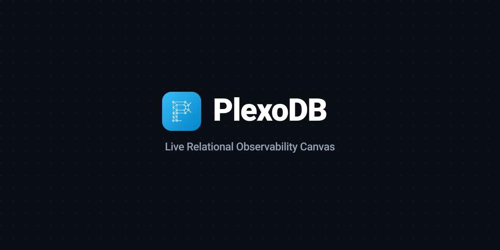
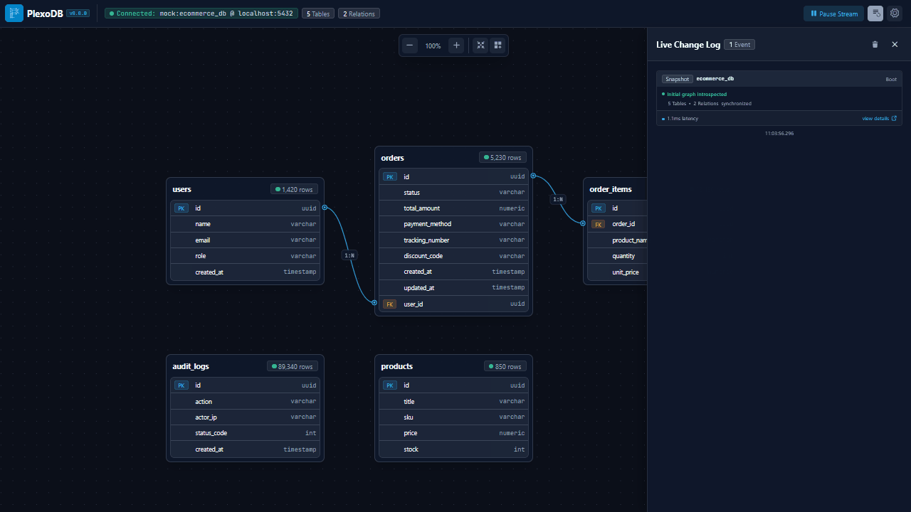
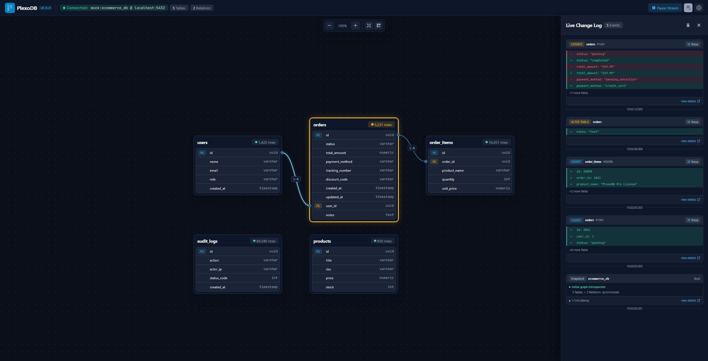
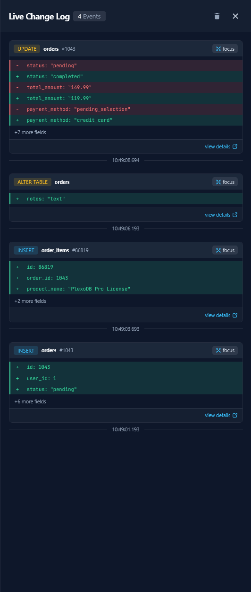
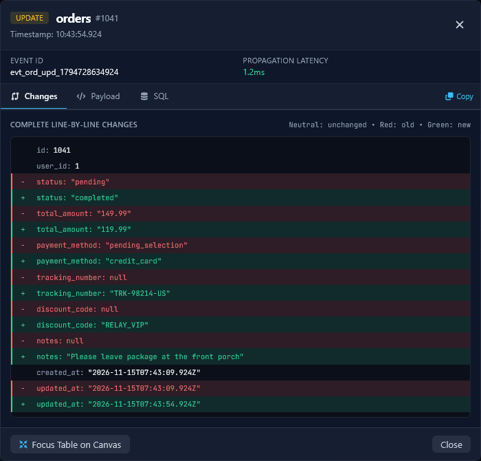
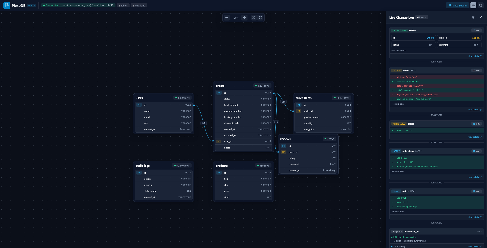
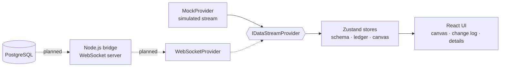

<div align="center">

  

<br /><br />

  <p><strong>Live Relational Observability Canvas</strong></p>
  <p>See your database's tables and relations as an interactive canvas, and watch schema and row changes happen as they occur.</p>

  <p>
    
    
    
    
  </p>

  <!-- TODO: add the live demo link after deploying -->
  <!-- <p><a href="https://YOUR-DEMO-URL"><strong>Live demo</strong></a></p> -->

</div>

<br />

<p align="center">
  
</p>

---

## Why PlexoDB?

When an API call touches several tables, the usual way to see what happened is to run queries by hand or keep refreshing a database client. PlexoDB is built to show it instead: the schema is drawn as a canvas, and every change shows up on it as it happens, with a change log that explains each one.

## Project status

> [!IMPORTANT]
> **PlexoDB is an early-stage project.** The front-end is built and runs against a **simulated event stream** (a mock `ecommerce_db`). The Node.js bridge and the real PostgreSQL connection are **planned, not built yet**.

|                      |                                                                                                                  |
| -------------------- | ---------------------------------------------------------------------------------------------------------------- |
| ✅ **Working today** | The canvas, relation wires, live change log, details modal and stream controls, all driven by a simulated stream |
| 🚧 **In progress**   | Session persistence, settings, canvas enhancements                                                               |
| 🗓️ **Planned**       | WebSocket client, Node.js bridge, PostgreSQL adapter, CLI                                                        |

## Screenshots

<table>
  <tr>
    <td width="50%"><br /><sub><b>The canvas</b>: tables, relations and the live change log.</sub></td>
    <td width="50%"><br /><sub><b>The change log</b>: row and schema events as cards.</sub></td>
  </tr>
  <tr>
    <td width="50%"><br /><sub><b>Details modal</b>: a before/after diff of a row update.</sub></td>
    <td width="50%"><br /><sub><b>Schema changes</b>: a new table appears on the canvas.</sub></td>
  </tr>
</table>

## Features

- **Interactive canvas**: infinite pan and zoom (zoom follows the cursor), draggable table cards, re-center and auto-arrange.
- **Relations drawn as wires**: SVG cubic-bezier connections with cardinality badges and pulse animations when related rows change.
- **Live change log**: a side drawer that records the most recent 50 events as cards.
  - Row events: `INSERT`, `UPDATE`, `DELETE`, with a before/after diff of the changed fields.
  - Schema events: create, alter and drop table.
  - An initial schema snapshot entry.
- **Details modal** for any log entry, with three tabs: **Diff**, **Payload** (the raw event as JSON) and **SQL**.
- **Focus from the log**: click an entry to pan the canvas to its table.
- **Stream controls**: pause and resume the stream, and clear the log (with confirmation).
- **Live indicators**: connection status, table and relation counts, per-table row counters, and highlights on active tables.

## How it works

PlexoDB is built **contract-first**: the UI only knows about a small data-stream interface, so the data source can change without touching the UI.



Solid lines work today, dashed lines are planned.

- **Events** are a typed discriminated union: `SCHEMA_SNAPSHOT`, `SCHEMA_MUTATED` and `ROW_MUTATED`.
- **Stores** are separate by responsibility: schema (tables, relations, mutations), ledger (an append-only, capped event log) and canvas (viewport, focus, theme).
- **The canvas engine is custom**: pan and zoom math, dragging, auto-layout, relation paths and the diff engine are written from scratch. There is no diagramming, graph or drag-and-drop library.
- **Domain model** is organised into `def` (classes), `meta` (interfaces and types) and `enums`.

## Tech stack

React 19 · TypeScript (strict) · Vite · Zustand · Tailwind CSS · SCSS · SVG

## Getting started

You need a recent Node.js LTS.

```bash
# Install dependencies
npm install

# Start the development server
npm run dev
```

Other scripts:

```bash
npm run build     # type-check and production build
npm run preview   # preview the production build
npm run lint      # run ESLint
```

### What to try in the demo

1. Let the stream run: a new simulated event arrives every 2.5 seconds, and the change log fills in.
2. Click **view details** on an `UPDATE` card and look through the Diff, Payload and SQL tabs.
3. Click an entry's table to focus it on the canvas.
4. Drag a card and watch its relation wires follow.
5. Use the toolbar to zoom, re-center or auto-arrange.
6. Pause the stream, then resume it.

## Project structure

```
src/
├── components/     UI: canvas, table cards, relation wires, change log, modals
├── core/
│   ├── def/        classes: table nodes, columns, relations, mock provider
│   ├── meta/       interfaces and types, including the stream contract
│   ├── enums/      shared enums
│   ├── hooks/      reusable hooks (dragging)
│   ├── mock/       the simulated database schema
│   └── utils/      pure helpers: bezier paths, coordinates, layout, diffing
├── store/          Zustand stores: schema, ledger, canvas, connection, modals
├── css/            SCSS design system
└── locales/        UI strings
```

## Roadmap

- [x] Interactive canvas with pan, zoom, dragging and auto-layout
- [x] Relation wires with cardinality badges and pulses
- [x] Live change log with row and schema event cards
- [x] Details modal (Diff, Payload, SQL)
- [x] Stream pause, resume and clear
- [ ] Session persistence (viewport and card positions)
- [ ] Settings (simulation speed, timestamp format, theme)
- [ ] Zoom to fit, hover highlighting of relations, click-to-filter the log
- [ ] WebSocket client provider with reconnect and heartbeat
- [ ] Node.js bridge and PostgreSQL adapter (opt-in change capture)
- [ ] Command-line tool for one-command startup
- [ ] Unit tests and CI

## License

MIT © [Karam Obida](https://github.com/Karam-Obd)
