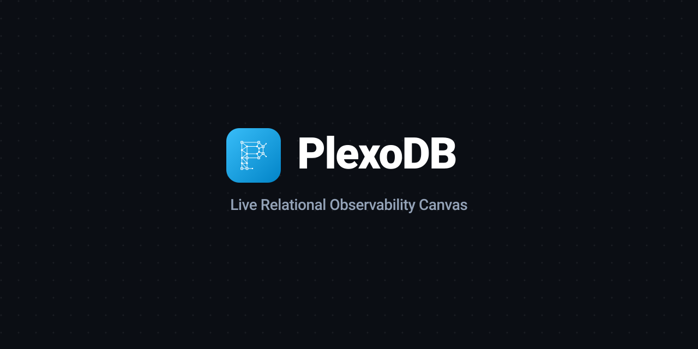

<div align="center">

  

  <br /><br />

  <p><strong>Live Relational Observability Canvas</strong></p>

  <p>
    
    
  </p>

</div>

---

> [!NOTE]
> 🚧 **PlexoDB is currently under active development.**

### Local Setup

```bash
# Install dependencies
npm install

# Start development server
npm run dev
```

---

### License

MIT © [Karam Obida](https://github.com/Karam-Obd)
